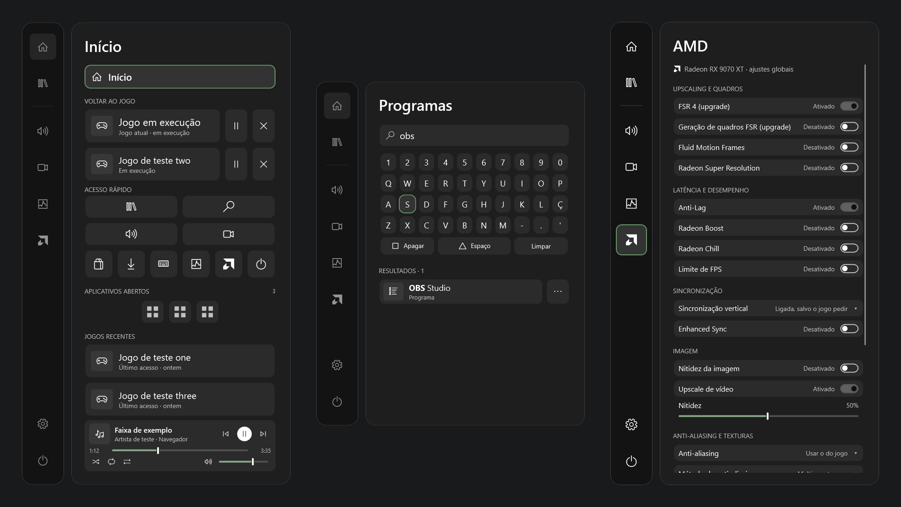
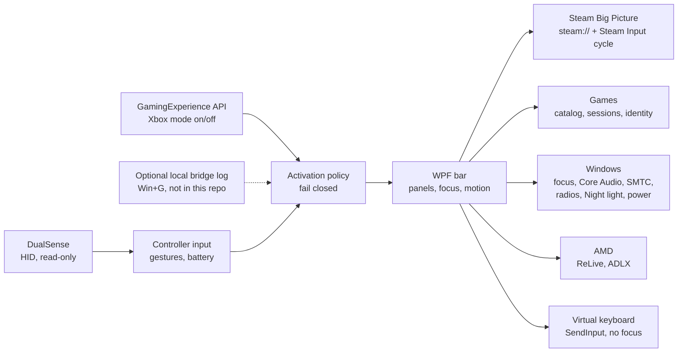

# XGB_P

**English** · **[Português (Brasil)](README.pt-BR.md)**

**A controller-first game bar for the Windows 11 Xbox full screen experience, built around Steam Big Picture and a DualSense — opened with the PS button, without touching a single Microsoft binary.**

[](https://github.com/Sitr3n01/XGB_P/actions/workflows/ci.yml)
[](https://github.com/Sitr3n01/XGB_P/actions/workflows/codeql.yml)
[](https://github.com/Sitr3n01/XGB_P/releases)
[](LICENSE)
[](#requirements)
[](docs/guias/desenvolvimento.md)

<p align="center">
  
  <br>
  <sub>Home, Recording and AMD panels, rendered from the verification fixtures. The interface is in Portuguese.</sub>
</p>

## The problem

The Xbox full screen experience turns a Windows 11 PC into a console-like device, but its overlay assumes an Xbox controller and the Xbox app. With Steam Big Picture as the shell and a DualSense driven through DSX, the PS button belongs to Steam, the stock Game Bar does not know your Steam games, and every overlay fights Steam for the controller.

XGB_P is the bar that setup is missing: one press of PS opens it over the game, the controller navigates it, and it hands input back to Steam cleanly when it closes. Getting there meant solving the hard parts properly:

- **Input ownership.** Steam keeps reading the controller while the bar is open. The bar opens only after the PS release, moves Steam to its desktop layout through a confirmed `steam://forceinputappid` cycle, and blocks navigation until Steam confirms the hand-off ([ADR 0041](docs/decisoes/0041-layout-de-desktop-da-steam-ao-abrir.md), [ADR 0074](docs/decisoes/0074-transferencia-rapida-do-steam-input-apos-soltar-ps.md)).
- **Focus in the Xbox mode.** The shell shows one window at a time and refuses focus to an app opened from raw HID input. The bar is a tool window that requests focus explicitly and gives it back to the exact window it came from ([ADR 0040](docs/decisoes/0040-foco-da-barra-e-camada-uiaccess.md), [ADR 0046](docs/decisoes/0046-entrega-de-foco-antes-de-ocultar-a-barra.md)).
- **Switching games without a ghost overlay.** Starting a second Steam game while one runs left Steam's overlay on top. The bar now closes the running game, waits for the native exit *and* for Steam to end that session, and only then launches the next one ([ADR 0070](docs/decisoes/0070-fechar-antes-de-iniciar-e-retorno-ao-inicio.md), [ADR 0072](docs/decisoes/0072-aguardar-encerramento-da-sessao-steam.md)).

## What it does

| Panel | Capabilities |
|---|---|
| **Home** | Every open game (current first) with pause, resume and close by process identity; app switcher with hold-to-close; three recent games; media player for the active session; quick access |
| **Library** | Opens Steam Big Picture straight at *Collections → All*, through a fast local channel when the Steam client is recognized |
| **Sound** | Output device, volume and mute, per-app mixer, microphone, media sources and seek. While the bar is open, the focused game or app plays at half volume |
| **Recording** | Radeon ReLive instant replay, screenshot and recording through AMD's own command tool; latest captures with thumbnails |
| **Performance** | HWiNFO sensors, RTSS frame rate and the Windows power mode. Missing data shows as unavailable, never as a made-up number |
| **AMD** | Global graphics settings through the driver's ADLX: FSR 4, frame generation, Fluid Motion Frames, Super Resolution, Anti-Lag, Boost, Chill, frame limit, sharpening, Enhanced Sync |
| **Settings** | Wi-Fi and Bluetooth (with headset battery), Night light, DSX, DualSense battery (physical, not the virtual pad), button icons, startup, interface sounds, reduced motion, activity history, leaving the Xbox mode, hiding the taskbar in the Xbox mode |
| **Power** | Suspend, restart and shut down, each behind a second confirmation focused on *Cancel* |

A **virtual keyboard** that never takes focus types into the app in front through `SendInput`, driven by the controller. In the Xbox mode it opens by itself when a text field gets focus.

## Results at a glance

| Measure | Result | Evidence |
|---|---|---|
| Steam navigation latency | Steam logs the command in **30–138 ms** through the local channel, against **1,090–1,153 ms** through the shell protocol | [ADR 0059](docs/decisoes/0059-despacho-local-da-navegacao-steam.md) |
| Transition cost | **95.9% fewer** Measure/Arrange passes per panel transition; **57.4% lower** median capture time | [ADR 0057](docs/decisoes/0057-apresentacao-com-custo-limitado.md#resultados-medidos) |
| Shipped executable | **718 KB**, down from 1,288 KB: verification code is compiled out, and `XGB_P.exe` rejects every `--verify*` argument | [CI gate](scripts/verificar-ci.ps1) |
| Local quality gate | **20 verification runs** per candidate: a functional and timing suite, two pause/resume/close runs on processes the test owns, and 14 read-only diagnostics of the real machine | [Quality policy](quality/README.md) |
| Background observer budget | p95 under 1 s, under 5% of one core, at most 16 retained handles after warm-up | [Quality policy](quality/README.md) |
| Decisions | **88 ADRs**, each with context, consequences and limits | [Decision records](docs/decisoes/README.md) |

## Architecture



One resident WPF process on the .NET Framework that ships with Windows: no runtime to install, no service, no driver. The activation policy reads the Xbox mode state from the official API and **fails closed**: if the state is unknown, the bar does not open. Game actions run on serialized transactions keyed by process ID *and* creation time, and a journal written before each pause lets the next launch resume games after a crash.

Full detail: [Architecture](docs/arquitetura.md) · [Requirements](docs/requisitos.md) · [ADRs](docs/decisoes/README.md) · [Technical references](docs/referencia/)

## Invariants

| Invariant | How it is enforced |
|---|---|
| The DualSense is read-only | No LED, rumble or trigger report is ever sent, so the bar never fights Steam or DSX. The gate rejects `HidD_SetOutputReport` and `HidD_SetFeature` in the source |
| No injection, no Microsoft binary touched | Public APIs only. The gate rejects `WriteProcessMemory`, `CreateRemoteThread` and `VirtualAllocEx` ([ADR 0001](docs/decisoes/0001-nao-modificar-binarios-microsoft.md)) |
| System changes are the user's | No packages, certificates, services or scheduled tasks. Elevation only through the normal UAC prompt |
| Processes are acted on by identity | Pause, resume and close re-check PID and creation time on the same handle, so a reused PID is not mistaken for the original game |
| Errors are reported, never invented | Timeouts and refusals end in an explicit message; there is no success by timeout |
| Nothing private in Git | CI rejects binaries, certificates, sounds and Microsoft package identities; Gitleaks scans the full history |

## Requirements

- Windows 11 x64 with the Xbox full screen experience. The app also runs on the desktop.
- Steam with Big Picture as the Xbox mode home app.
- A DualSense through [DSX](https://store.steampowered.com/app/1812620/DSX/), with the physical controller allowed to XGB_P in [HidHide](https://github.com/nefarius/HidHide).
- Optional: AMD Software: Adrenalin Edition (Recording and AMD panels), HWiNFO and RTSS (Performance panel).

**Opening the bar.** In the Xbox mode, press PS or use the tray icon. Opening with Win+G depends on a local bridge to the shell that is not distributed ([ADR 0002](docs/decisoes/0002-identidade-do-pacote-da-game-bar.md)). Without it, Win+G keeps opening the stock Game Bar and everything else works.

## Getting started

Download the latest release, verify it, extract it and run `XGB_P.exe`:

```powershell
Get-FileHash .\XGB_P-2.1.0-win-x64.zip -Algorithm SHA256
```

```powershell
gh attestation verify .\XGB_P-2.1.0-win-x64.zip --repo Sitr3n01/XGB_P
```

Compare the hash with `SHA256SUMS.txt` from the same release. The executable is not Authenticode-signed, so SmartScreen may warn on first launch. Setup, HidHide and data locations: [installation and use](docs/guias/instalacao-e-uso.md).

To build from source (no SDK: the C# compiler that ships with Windows):

```powershell
powershell -NoProfile -ExecutionPolicy Bypass -File .\scripts\compilar-xgb.ps1 -Verificar
```

## Project status

**v2.1.0 release candidate — physical validation pending.** Every feature above is implemented and passes the automated gate, and the app has been in daily use on the author's machine since October 2026. What the automated gate cannot prove is still open and listed in the [roadmap](docs/roadmap.md): the full physical matrix in the Xbox mode (Steam, DSX, real games, TV and DPI), real power actions, and a long session on the final build. Until then, releases are published as pre-releases.

The app is built for one setup and tested on one machine (Ryzen 7 7700X, Radeon RX 9070 XT, Windows 11 build 26300). The Steam integration reads Steam's own local files, which are not a public contract and can change with any Steam update.

## Engineering practices

**Two builds, one source.** `XGB_P.exe` and `XGB_P.Tests.exe` compile from the same `src/`. The test build adds `tests/` and the `XGB_VERIFY` symbol; the product build has no verification code at all.

**Receipts, not logs.** Each verification run writes a receipt bound to a fresh GUID, the mode, the executable's SHA-256 and a UTC window. The gate refuses stale, foreign or tampered receipts, and has negative tests for each field. A source fingerprint taken before and after the battery rejects a run during which the code changed.

**Fixtures for effects.** Power, Steam, radios and settings are replaced by substitutes in the suites. The live checks only read the real machine or act on processes and windows the test itself created.

**Ratchets.** `quality/policy.json` caps file length and line width. Legacy debt is recorded per file and can only go down.

**Decision records.** Every behavior change that matters has an [ADR](docs/decisoes/README.md), including the ones that reversed an earlier decision and why.

## How this was built

A solo project, built with AI coding assistants (Claude Code and OpenAI Codex). The owner sets the direction and makes the calls the documents record: scope, which trade-offs are acceptable, what was validated physically and what was not. Every change, whoever drafted it, passes the same gate.

The public history starts at v2.1.0. Earlier development, including session logs, raw evidence and the local activation bridge, stays in a private archive because it contains machine-specific data.

## Repository map

```
src/app/        WPF application: panels, activation, focus, Steam, games, keyboard, motion
src/lib/        Windows integrations by area: dualsense, gaming, games, windows, audio,
                media, hardware, network, display, amd, input, runtime
tests/          verification suites, compiled only into XGB_P.Tests.exe
tools/          read-only diagnostics (DualSense reader, Xbox mode monitor) and the
                presentation microbenchmark
scripts/        build, verification battery, quality gate, CI gate, packaging
quality/        gate policy (versions, ratchets, required modes, manual approvals)
docs/           architecture, requirements, roadmap, ADRs, references, design, guides
.github/        CI, CodeQL, release, Dependabot, issue and pull request templates
```

## Documentation

| Document | Contents |
|---|---|
| [Installation and use](docs/guias/instalacao-e-uso.md) | Requirements, HidHide, opening and closing, data, startup, rollback |
| [Development](docs/guias/desenvolvimento.md) | Toolchain, builds, verification battery, gates, releases |
| [Architecture](docs/arquitetura.md) | Components, activation, focus and Steam, operations, data |
| [Requirements](docs/requisitos.md) | Scope, controls, features, dependencies, approval criteria |
| [Roadmap](docs/roadmap.md) | What is done, what is pending and what is out of scope |
| [ADRs](docs/decisoes/README.md) | Decision records, with index |
| [References](docs/referencia/) | Windows, Steam, DualSense and AMD facts the code depends on |
| [Design](docs/design/README.md) | Palette, motion, sound and Home layout |
| [Changelog](CHANGELOG.md) | Notable changes per version |
| [Security policy](SECURITY.md) | Private reporting and the app's safety invariants |
| [Contributing](CONTRIBUTING.md) · [Code of conduct](CODE_OF_CONDUCT.md) | How changes are made and reviewed |

## License

[Apache License 2.0](LICENSE). Third-party products, trademarks and the no-affiliation statement are in [NOTICE](NOTICE). XGB_P is an independent project, not affiliated with Microsoft, Sony, Valve or AMD.
