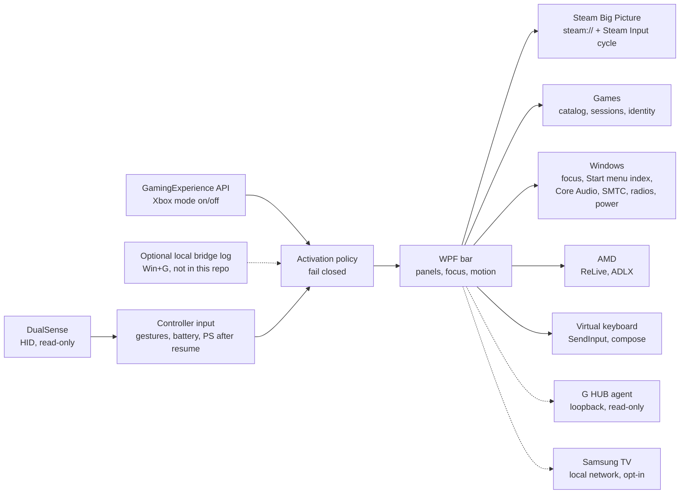

# XGB_P

**English** · **[Português (Brasil)](README.pt-BR.md)**

**A controller-first game bar for the Windows 11 Xbox full screen experience, built around Steam Big Picture and a DualSense — opened with the PS button, without touching a single Microsoft binary.**

[](https://github.com/Sitr3n01/XGB_P/actions/workflows/ci.yml)
[](https://github.com/Sitr3n01/XGB_P/actions/workflows/codeql.yml)
[](CHANGELOG.md)
[](LICENSE)
[](#requirements)
[](docs/guias/desenvolvimento.md)

<p align="center">
  
  <br>
  <sub>Home, Programs and AMD in 3.0.0, rendered by the verification suite from fixture data: the games, apps and devices are test values, not a real machine. The interface is in Portuguese.</sub>
</p>

## The problem

The Xbox full screen experience turns a Windows 11 PC into a console-like device, but its overlay assumes an Xbox controller and the Xbox app. With Steam Big Picture as the shell and a DualSense driven through DSX, the PS button belongs to Steam, the stock Game Bar does not know your Steam games, and every overlay fights Steam for the controller.

XGB_P is the bar that setup is missing: one press of PS opens it over the game, the controller navigates it, and it hands input back to Steam cleanly when it closes. Getting there meant solving the hard parts properly:

- **Input ownership.** Steam keeps reading the controller while the bar is open. The bar opens only after the PS release, moves Steam to its desktop layout through a confirmed `steam://forceinputappid` cycle, and blocks navigation until Steam confirms the hand-off ([ADR 0041](docs/decisoes/0041-layout-de-desktop-da-steam-ao-abrir.md), [ADR 0074](docs/decisoes/0074-transferencia-rapida-do-steam-input-apos-soltar-ps.md)).
- **Focus in the Xbox mode.** The shell shows one window at a time and refuses focus to an app opened from raw HID input. The bar is a tool window that requests focus explicitly and gives it back to the exact window it came from ([ADR 0040](docs/decisoes/0040-foco-da-barra-e-camada-uiaccess.md), [ADR 0046](docs/decisoes/0046-entrega-de-foco-antes-de-ocultar-a-barra.md)).
- **Switching games without a ghost overlay.** Starting a second Steam game while one runs left Steam's overlay on top. The bar closes the running game, waits for the native exit *and* for Steam to end that session, and only then launches the next one ([ADR 0070](docs/decisoes/0070-fechar-antes-de-iniciar-e-retorno-ao-inicio.md), [ADR 0072](docs/decisoes/0072-aguardar-encerramento-da-sessao-steam.md)).

## What it does

| Panel | Capabilities |
|---|---|
| **Home** | *Back to game* first: every open game, current first, with pause, resume and close by process identity. Then quick access (four wide shortcuts and six square ones), the open apps with hold-to-close, three recent games and the media player for the active session ([ADR 0105](docs/decisoes/0105-voltar-ao-jogo-acima-do-acesso-rapido.md)) |
| **Programs** | Searches the Start menu index without accents, by initials and aliases, ranked by use, typed on a built-in keyboard driven by the controller. Launches through Explorer so a program does not inherit the bar's elevation, and brings a program that is already open to the front ([ADR 0096](docs/decisoes/0096-pesquisa-de-programas-pelo-acesso-rapido.md)) |
| **Library** | Opens Steam Big Picture straight at *Collections → All*, through a fast local channel when the Steam client is recognized |
| **Sound** | Output device, volume and mute, per-app mixer, microphone, media sources and seek. While the bar is open, the game or app in front plays at half volume |
| **Recording** | Radeon ReLive instant replay, screenshot and recording through AMD's own command tool; latest captures with thumbnails; a warning when recording with the microphone muted |
| **Performance** | HWiNFO sensors, RTSS frame rate and the Windows power mode. Missing data shows as unavailable, never as a made-up number |
| **AMD** | Global graphics settings through the driver's ADLX, grouped by upscaling and frames, latency, sync, image, anti-aliasing and maintenance; every change is re-read from the driver ([ADR 0100](docs/decisoes/0100-mais-opcoes-globais-da-amd-no-painel.md)) |
| **Settings** | Ten sections, from Connections (Wi-Fi, Bluetooth, headset batteries) and Display (Night light, the TV) to Controller (DSX, button icons, PS wake), the virtual keyboard, the interface, the Xbox mode (hiding the taskbar, leaving the mode), startup, the activity history and About ([ADR 0112](docs/decisoes/0112-trilho-lateral-como-opcao-e-ordem-das-configuracoes.md)) |
| **Controller and power** | DualSense status; suspend, restart and shut down, each behind a second confirmation focused on *Cancel*; TV on and off once the TV integration is set up |

The **status strip** shows the time, the network, the physical DualSense battery (not DSX's virtual pad), headset batteries and a red, struck-through microphone while the default microphone is muted. Over a Big Picture screen, which already shows a clock, the bar hides its own and moves the strip next to the panel title.

The **virtual keyboard** types into desktop apps without taking focus. Opened by hand over a catalogued game, it takes focus to compose a line, gives focus back and sends the text on Menu; Circle cancels ([ADR 0101](docs/decisoes/0101-teclado-sobre-jogos-compor-e-enviar.md)). It opens by itself only in the Xbox mode, when a text field gets focus.

**Optional integrations**, each off or read-only until you set it up:

- **Logitech LIGHTSPEED headsets:** battery, charging and estimated time from the local G HUB agent, through read requests only ([ADR 0106](docs/decisoes/0106-bateria-de-fones-pelo-g-hub.md)).
- **Samsung Tizen TVs:** power commands, a confirmed-screen state and opt-in rules for suspend, resume, display topology and HDR. Automation starts disabled, and the configuration is imported from an existing local setup; there is no discovery wizard yet ([guide](docs/guias/tv-samsung-integrada.md), ADRs [0110](docs/decisoes/0110-integracao-da-tv-samsung.md)–[0111](docs/decisoes/0111-tv-integrada-comandos-automacao-e-retomada.md)).
- **Waking the PC with PS:** a read-only readiness check in Settings and on the suspend confirmation, plus reversible scripts that *you* run to arm only Bluetooth DualSense instances ([guide](docs/guias/despertar-pelo-ps.md), [ADR 0114](docs/decisoes/0114-bootps-reversivel-e-identificador-de-retomada.md)).

## Screenshots

| Settings | Samsung TV (optional) | Recording |
|---|---|---|
|  |  |  |
| **Sound** | **Performance** | **Controller and power** |
|  |  |  |

| Virtual keyboard | Composing over a game |
|---|---|
|  |  |

<details>
<summary>Without the side rail</summary>
<br>

<br>
<sub>Settings → Interface → <i>Trilho lateral</i> turns the rail off. Each panel keeps its title, with an arrow to the next one; the choice applies at once and is saved (<a href="docs/decisoes/0112-trilho-lateral-como-opcao-e-ordem-das-configuracoes.md">ADR 0112</a>).</sub>
</details>

<sub>Every screenshot is a render of the 3.0.0 test build from fixture data. They show the layouts and states the suites assert, not a capture of a real session. Where each image comes from: [docs/images](docs/images/README.md).</sub>

## Results at a glance

| Measure | Result | Evidence |
|---|---|---|
| Steam navigation latency | Steam logs the command in **30–138 ms** through the local channel, against **1,090–1,153 ms** through the shell protocol | [ADR 0059](docs/decisoes/0059-despacho-local-da-navegacao-steam.md) |
| Transition cost | **95.9% fewer** Measure/Arrange passes per panel transition; **57.4% lower** median capture time | [ADR 0057](docs/decisoes/0057-apresentacao-com-custo-limitado.md#resultados-medidos) |
| Product without test code | `XGB_P.exe` is **1.0 MB** in the 3.0.0 validation build, against **1.9 MB** for `XGB_P.Tests.exe`; the product rejects every `--verify*` argument | [3.0.0 port report](docs/atualizacao-publica-2026-11-08.md#validação) |
| Fixture suites | Among others, **155** checks for the TV core, **41** for PS wake and **70** for the title layout, plus **11** isolated cases for the wake scripts with the registry and WMI replaced | [3.0.0 port report](docs/atualizacao-publica-2026-11-08.md#validação) |
| Local quality gate | **22 verification modes** required per candidate: functional and timing suites, pause/resume/close runs on processes the test owns, and read-only diagnostics of the real machine | [Quality policy](quality/README.md) |
| Background observer budget | p95 under 1 s, under 5% of one core, at most 16 retained handles after warm-up | [Quality policy](quality/README.md) |
| Decisions | **114 ADRs**, each with context, consequences and limits | [Decision records](docs/decisoes/README.md) |

## Architecture



One resident WPF process on the .NET Framework that ships with Windows: no runtime to install, no service, no driver. The activation policy reads the Xbox mode state from the official API and **fails closed**: if the state is unknown, the bar does not open. Game actions run on serialized transactions keyed by process ID *and* creation time, and a journal written before each pause lets the next launch resume games after a crash. The TV runs in the same process, on its own serialized queue, and the PS press after a resume comes from the same single HID reader.

Full detail: [Architecture](docs/arquitetura.md) · [Requirements](docs/requisitos.md) · [ADRs](docs/decisoes/README.md) · [Technical references](docs/referencia/)

## Invariants

| Invariant | How it is enforced |
|---|---|
| The DualSense is read-only | No LED, rumble or trigger report is ever sent, so the bar never fights Steam or DSX. The gate rejects `HidD_SetOutputReport` and `HidD_SetFeature` in the source |
| No injection, no Microsoft binary touched | Public APIs only. The gate rejects `WriteProcessMemory`, `CreateRemoteThread` and `VirtualAllocEx` ([ADR 0001](docs/decisoes/0001-nao-modificar-binarios-microsoft.md)) |
| System changes are the user's | No packages, certificates, services or scheduled tasks. Elevation only through the normal UAC prompt. The wake policy scripts are run by the user, preview with `-WhatIf` and undo only their own backup |
| Processes are acted on by identity | Pause, resume and close re-check PID and creation time on the same handle, so a reused PID is not mistaken for the original game |
| Errors are reported, never invented | Timeouts and refusals end in an explicit message; there is no success by timeout. A TV power toggle that was, or may have been, delivered is never repeated automatically |
| Other devices are read, not driven | G HUB is asked only for its device list and battery state; the microphone watcher never calls `SetMute` |
| Nothing private in Git | CI rejects binaries, certificates, sounds and Microsoft package identities; Gitleaks scans the full history. TV examples use fictitious identifiers |

## Requirements

- Windows 11 x64 with the Xbox full screen experience. The app also runs on the desktop.
- Steam with Big Picture as the Xbox mode home app.
- A DualSense through [DSX](https://store.steampowered.com/app/1812620/DSX/), with the physical controller allowed to XGB_P in [HidHide](https://github.com/nefarius/HidHide).
- Optional: AMD Software: Adrenalin Edition (Recording and AMD panels), HWiNFO and RTSS (Performance panel), Logitech G HUB (LIGHTSPEED headset battery), a Samsung Tizen TV with an existing local configuration (TV integration).

**Opening the bar.** In the Xbox mode, press PS or use the tray icon. Opening with Win+G depends on a local bridge to the shell that is not distributed ([ADR 0002](docs/decisoes/0002-identidade-do-pacote-da-game-bar.md)). Without it, Win+G keeps opening the stock Game Bar and everything else works.

## Getting started

**No release has been published yet.** The [release workflow](.github/workflows/release.yml) builds one from a `v*` tag, with the ZIP, `SHA256SUMS.txt` and a build provenance attestation. Until then, build from source. No SDK is needed: the C# compiler ships with Windows.

```powershell
powershell -NoProfile -ExecutionPolicy Bypass -File .\scripts\compilar-xgb.ps1 -Verificar
```

This builds `XGB_P.exe` and `XGB_P.Tests.exe` into `bin\app` and runs the functional suite on fixture data. Setup, HidHide, data locations and rollback: [installation and use](docs/guias/instalacao-e-uso.md).

Once a release exists, check the download against `SHA256SUMS.txt` and its attestation before running it:

```powershell
gh attestation verify .\XGB_P-3.0.0-win-x64.zip --repo Sitr3n01/XGB_P
```

The executable is not Authenticode-signed, so SmartScreen may warn on first launch.

## Project status

**v3.0.0 source candidate — physical validation pending.** The features above are implemented and passed the local gate of the 3.0.0 port: the CI script (static checks, both builds, the wake script cases and the product's refusal of test modes), six receipted verification runs and a review of the renders. The app is in daily use on the author's machine.

Still open, and tracked in the [roadmap](docs/roadmap.md):

- **The physical matrix in the Xbox mode:** Steam, DSX, real games, program search, the keyboard over games, G HUB, the DSX mute button, the TV and DPI. Real power actions and a real TV were not exercised for this version.
- **CI on GitHub.** The last run on `main`, still 2.1.0, failed because Windows limits a window to the screen, so on the runner the bar was laid out smaller than the 1920 × 1080 the suites ask for. The test build now lifts that limit and always lays the suites out at the requested size; a second dependency, on the Windows animation setting, was fixed the same way. Both fixes pass locally with a 1024 × 768 screen and animations off emulated.
- **The PS wake trace** records a PS seen after a resume as a correlation, never as proof that the controller woke the PC.

The app is built for one setup and tested on one machine (Ryzen 7 7700X, Radeon RX 9070 XT, Windows 11 build 26300). The Steam integration reads Steam's own local files, which are not a public contract and can change with any Steam update.

## Engineering practices

**Two builds, one source.** `XGB_P.exe` and `XGB_P.Tests.exe` compile from the same `src/`. The test build adds `tests/` and the `XGB_VERIFY` symbol; the product build has no verification code at all.

**Receipts, not logs.** Each verification run writes a receipt bound to a fresh GUID, the mode, the executable's SHA-256 and a UTC window. The gate refuses stale, foreign or tampered receipts, and has negative tests for each field. A source fingerprint taken before and after the battery rejects a run during which the code changed.

**Fixtures for effects.** Power, Steam, radios, the TV transport, the registry and WMI are replaced by substitutes in the suites; the TV TLS tests use an ephemeral pair bound to loopback. The live checks only read the real machine or act on processes and windows the test itself created.

**Ratchets.** `quality/policy.json` caps file length and line width. Legacy debt is recorded per file and can only go down; the 3.0.0 port lowered 17 caps and raised none.

**Decision records.** Every behavior change that matters has an [ADR](docs/decisoes/README.md), including the ones that reversed an earlier decision and why.

## How this was built

A solo project, built with AI coding assistants (Claude Code and OpenAI Codex). The owner sets the direction and makes the calls the documents record: scope, which trade-offs are acceptable, which design proposals were approved, what was validated physically and what was not. Every change, whoever drafted it, passes the same gate.

The public history starts at v2.1.0. Earlier development, including session logs, raw evidence and the local activation bridge, stays in a private archive because it contains machine-specific data.

## Repository map

```
src/app/        WPF application: panels, activation, focus, Steam, games, programs,
                keyboard, TV and wake settings, motion
src/lib/        Windows integrations by area: dualsense, gaming, games, windows, audio,
                media, hardware, network, display, amd, input, power, tv, runtime
tests/          verification suites, compiled only into XGB_P.Tests.exe
tools/          read-only diagnostics (DualSense reader, Xbox mode monitor) and the
                presentation microbenchmark
scripts/        build, verification battery, quality and CI gates, packaging, and the
                user-run PS wake scripts
quality/        gate policy (versions, ratchets, required modes, manual approvals)
licenses/       license of the embedded DualSense artwork
docs/           architecture, requirements, roadmap, ADRs, references, design, guides
.github/        CI, CodeQL, release, Dependabot, issue and pull request templates
```

## Documentation

| Document | Contents |
|---|---|
| [Installation and use](docs/guias/instalacao-e-uso.md) | Requirements, HidHide, opening and closing, data, startup, rollback |
| [Samsung TV](docs/guias/tv-samsung-integrada.md) | Local setup, operation, validation and rollback of the optional TV integration |
| [Waking with PS](docs/guias/despertar-pelo-ps.md) | Readiness check, the reversible scripts and the resume trace |
| [Development](docs/guias/desenvolvimento.md) | Toolchain, builds, verification battery, gates, releases |
| [Architecture](docs/arquitetura.md) | Components, activation, focus and Steam, operations, data |
| [Requirements](docs/requisitos.md) | Scope, controls, features, dependencies, approval criteria |
| [Roadmap](docs/roadmap.md) | What is done, what is pending and what is out of scope |
| [3.0.0 port report](docs/atualizacao-publica-2026-11-08.md) | What changed since 2.1.0, how it was adapted and validated, what was not tested |
| [ADRs](docs/decisoes/README.md) | Decision records, with index |
| [References](docs/referencia/) | Windows, Steam, DualSense and AMD facts the code depends on |
| [Design](docs/design/README.md) | Palette, motion, sound and Home layout |
| [Changelog](CHANGELOG.md) | Notable changes per version |
| [Security policy](SECURITY.md) | Private reporting and the app's safety invariants |
| [Contributing](CONTRIBUTING.md) · [Code of conduct](CODE_OF_CONDUCT.md) | How changes are made and reviewed |

The documentation is written in Portuguese, the author's language; this README and the changelog are also in English.

## License

[Apache License 2.0](LICENSE). The DualSense outline is the PS5 artwork from [Controllercons](https://github.com/controllercons/controllercons.github.io) by Kieran McClung, under the [SIL Open Font License 1.1](licenses/Controllercons-OFL-1.1.txt). Third-party products, trademarks and the no-affiliation statement are in [NOTICE](NOTICE). XGB_P is an independent project, not affiliated with Microsoft, Sony, Valve, AMD, Logitech or Samsung.
