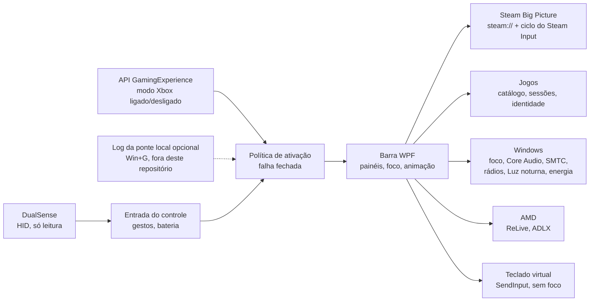

# XGB_P

**[English](README.md)** · **Português (Brasil)**

**Uma barra de jogo feita para o controle no modo Xbox do Windows 11, pensada para o Steam Big Picture e o DualSense: abre no botão PS, sem tocar em nenhum binário da Microsoft.**

[](https://github.com/Sitr3n01/XGB_P/actions/workflows/ci.yml)
[](https://github.com/Sitr3n01/XGB_P/actions/workflows/codeql.yml)
[](https://github.com/Sitr3n01/XGB_P/releases)
[](LICENSE)
[](#requisitos)
[](docs/guias/desenvolvimento.md)

<p align="center">
  
  <br>
  <sub>Painéis Início, Gravação e AMD, renderizados a partir dos dados de teste das verificações.</sub>
</p>

## O problema

O modo Xbox do Windows 11 transforma o PC num console, mas o overlay dele parte do princípio de que você usa um controle Xbox e o app Xbox. Com o Steam Big Picture como tela inicial e um DualSense pelo DSX, o botão PS pertence à Steam, a Game Bar original não conhece seus jogos da Steam e qualquer overlay disputa o controle com a Steam.

O XGB_P é a barra que falta nessa configuração: um toque no PS abre a barra sobre o jogo, o controle navega por ela e, ao fechar, o controle volta para a Steam sem conflito. Chegar lá exigiu resolver direito as partes difíceis:

- **Quem é dono do controle.** A Steam continua lendo o controle com a barra aberta. A barra só abre depois de o PS ser solto, coloca a Steam no layout de desktop por um ciclo `steam://forceinputappid` confirmado e bloqueia a navegação até a Steam confirmar a troca ([ADR 0041](docs/decisoes/0041-layout-de-desktop-da-steam-ao-abrir.md), [ADR 0074](docs/decisoes/0074-transferencia-rapida-do-steam-input-apos-soltar-ps.md)).
- **Foco no modo Xbox.** O shell mostra uma janela por vez e recusa o foco a um app aberto pela leitura direta do HID. A barra é uma janela de ferramenta que pede o foco explicitamente e o devolve à janela exata de onde veio ([ADR 0040](docs/decisoes/0040-foco-da-barra-e-camada-uiaccess.md), [ADR 0046](docs/decisoes/0046-entrega-de-foco-antes-de-ocultar-a-barra.md)).
- **Trocar de jogo sem overlay fantasma.** Abrir um segundo jogo da Steam com outro rodando deixava o overlay da Steam por cima. Agora a barra fecha o jogo aberto, espera a saída do processo **e** o fim da sessão na Steam, e só então abre o próximo ([ADR 0070](docs/decisoes/0070-fechar-antes-de-iniciar-e-retorno-ao-inicio.md), [ADR 0072](docs/decisoes/0072-aguardar-encerramento-da-sessao-steam.md)).

## O que faz

| Painel | Recursos |
|---|---|
| **Início** | Todos os jogos abertos (o atual primeiro), com pausar, retomar e fechar pela identidade do processo; alternância de apps com segurar para fechar; três jogos recentes; player de mídia da sessão ativa; acesso rápido |
| **Biblioteca** | Abre o Steam Big Picture direto em *Coleções → Todos*, por um canal local rápido quando o cliente da Steam é reconhecido |
| **Som** | Saída de áudio, volume e mute, mixer por aplicativo, microfone, fontes de mídia e posição da faixa |
| **Gravação** | Repetição instantânea, foto e gravação do Radeon ReLive pela ferramenta de comandos da própria AMD; últimas capturas com miniaturas |
| **Desempenho** | Sensores do HWiNFO, FPS do RTSS e modo de energia do Windows. Dado ausente aparece como indisponível, nunca como número inventado |
| **AMD** | Ajustes gráficos globais pelo ADLX do driver: FSR 4, geração de quadros, Fluid Motion Frames, Super Resolution, Anti-Lag, Boost, Chill, limite de FPS, nitidez e Enhanced Sync |
| **Configurações** | Wi-Fi e Bluetooth, Luz noturna, DSX, bateria do DualSense (o físico, não o virtual), ícones dos botões, inicialização, sons da interface, movimento reduzido, histórico de atividade e saída do modo Xbox |
| **Energia** | Suspender, reiniciar e desligar, cada um com uma segunda confirmação com foco em *Cancelar* |

Um **teclado virtual** que nunca rouba o foco digita no app da frente pelo `SendInput`, controlado pelo controle. No modo Xbox, ele abre sozinho quando um campo de texto recebe o foco.

## Resultados

| Medida | Resultado | Evidência |
|---|---|---|
| Latência da navegação na Steam | A Steam registra o comando em **30–138 ms** pelo canal local, contra **1.090–1.153 ms** pelo protocolo do shell | [ADR 0059](docs/decisoes/0059-despacho-local-da-navegacao-steam.md) |
| Custo das transições | **95,9% menos** passagens de Measure/Arrange por transição de painel; mediana da captura **57,4% menor** | [ADR 0057](docs/decisoes/0057-apresentacao-com-custo-limitado.md#resultados-medidos) |
| Executável publicado | **718 KB**, antes 1.288 KB: o código de verificação sai da compilação, e o `XGB_P.exe` recusa qualquer argumento `--verify*` | [Gate de CI](scripts/verificar-ci.ps1) |
| Gate local de qualidade | **20 execuções de verificação** por candidata: suíte funcional e temporal, duas rodadas de pausar/retomar/fechar em processos do próprio teste e 14 diagnósticos somente leitura da máquina real | [Política de qualidade](quality/README.md) |
| Orçamento do observador | p95 abaixo de 1 s, menos de 5% de um núcleo e no máximo 16 handles retidos depois do aquecimento | [Política de qualidade](quality/README.md) |
| Decisões | **88 ADRs**, cada uma com contexto, consequências e limites | [Registros de decisão](docs/decisoes/README.md) |

## Arquitetura



Um único processo WPF residente, no .NET Framework que já vem com o Windows: sem runtime para instalar, sem serviço, sem driver. A política de ativação lê o estado do modo Xbox pela API oficial e **falha fechada**: se o estado é desconhecido, a barra não abre. As ações sobre jogos rodam em transações serializadas, identificadas pelo ID **e** pela criação do processo, e um diário gravado antes de cada pausa permite que a próxima abertura retome os jogos depois de uma queda.

Detalhes: [Arquitetura](docs/arquitetura.md) · [Requisitos](docs/requisitos.md) · [ADRs](docs/decisoes/README.md) · [Referências técnicas](docs/referencia/)

## Invariantes

| Invariante | Como é garantida |
|---|---|
| O DualSense é só leitura | Nenhum relatório de LED, vibração ou gatilho é enviado, então a barra não briga com a Steam nem com o DSX. O gate recusa `HidD_SetOutputReport` e `HidD_SetFeature` no código |
| Sem injeção, nenhum binário da Microsoft alterado | Só APIs públicas. O gate recusa `WriteProcessMemory`, `CreateRemoteThread` e `VirtualAllocEx` ([ADR 0001](docs/decisoes/0001-nao-modificar-binarios-microsoft.md)) |
| Mudanças no sistema são do usuário | Sem pacotes, certificados, serviços ou tarefas agendadas. Elevação só pelo UAC normal |
| Processos são tratados pela identidade | Pausar, retomar e fechar conferem ID e criação do processo no mesmo handle, para que um ID reaproveitado não seja confundido com o jogo original |
| Erro é informado, nunca inventado | Prazos esgotados e recusas terminam numa mensagem explícita; não existe sucesso por timeout |
| Nada privado no Git | A CI recusa binários, certificados, sons e identidades de pacote da Microsoft; o Gitleaks varre todo o histórico |

## Requisitos

- Windows 11 x64 com o modo Xbox. O app também roda no desktop.
- Steam com o Big Picture como app inicial do modo Xbox.
- DualSense pelo [DSX](https://store.steampowered.com/app/1812620/DSX/), com o controle físico liberado para o XGB_P no [HidHide](https://github.com/nefarius/HidHide).
- Opcionais: AMD Software: Adrenalin Edition (painéis Gravação e AMD), HWiNFO e RTSS (painel Desempenho).

**Como abrir a barra.** No modo Xbox, aperte PS ou use o ícone da bandeja. Abrir pelo Win+G depende de uma ponte local com o shell que não é distribuída ([ADR 0002](docs/decisoes/0002-identidade-do-pacote-da-game-bar.md)). Sem ela, o Win+G continua abrindo a Game Bar original, e todo o resto funciona.

## Como começar

Baixe a release mais recente, confira, extraia e abra o `XGB_P.exe`:

```powershell
Get-FileHash .\XGB_P-2.1.0-win-x64.zip -Algorithm SHA256
```

```powershell
gh attestation verify .\XGB_P-2.1.0-win-x64.zip --repo Sitr3n01/XGB_P
```

Compare o hash com o `SHA256SUMS.txt` da mesma release. O executável não tem assinatura Authenticode, então o SmartScreen pode avisar na primeira abertura. Configuração, HidHide e onde ficam os dados: [instalação e uso](docs/guias/instalacao-e-uso.md).

Para compilar a partir do código (sem SDK: o compilador de C# que já vem com o Windows):

```powershell
powershell -NoProfile -ExecutionPolicy Bypass -File .\scripts\compilar-xgb.ps1 -Verificar
```

## Situação do projeto

**v2.1.0 candidata — validação física pendente.** Todos os recursos acima estão implementados e passam no gate automático, e o app está em uso diário na máquina do autor desde outubro de 2026. O que o gate automático não consegue provar continua em aberto e está no [roadmap](docs/roadmap.md): a matriz física completa no modo Xbox (Steam, DSX, jogos reais, TV e DPI), as ações de energia reais e uma sessão longa na build final. Até lá, as releases saem como pre-release.

O app foi feito para uma configuração e testado numa máquina (Ryzen 7 7700X, Radeon RX 9070 XT, Windows 11 build 26300). A integração com a Steam lê arquivos locais da própria Steam, que não são um contrato público e podem mudar a qualquer atualização.

## Práticas de engenharia

**Duas builds, um código.** `XGB_P.exe` e `XGB_P.Tests.exe` saem do mesmo `src/`. A build de testes soma `tests/` e o símbolo `XGB_VERIFY`; a build de produto não tem nenhum código de verificação.

**Recibos, não logs.** Cada execução de verificação grava um recibo ligado a um GUID novo, ao modo, ao SHA-256 do executável e a uma janela UTC. O gate recusa recibos antigos, de outra build ou adulterados, e tem testes negativos para cada campo. Uma impressão digital dos fontes, tirada antes e depois da bateria, recusa a execução se o código mudou no meio.

**Substitutos para efeitos.** Energia, Steam, rádios e configurações são trocados por substitutos nas suítes. As verificações "live" só leem a máquina real ou agem sobre processos e janelas criados pelo próprio teste.

**Catracas.** O `quality/policy.json` limita o tamanho dos arquivos e a largura das linhas. A dívida antiga fica registrada por arquivo e só pode diminuir.

**Registros de decisão.** Toda mudança de comportamento que importa tem uma [ADR](docs/decisoes/README.md), inclusive as que reverteram uma decisão anterior, com o motivo.

## Como foi feito

Projeto individual, construído com assistentes de programação com IA (Claude Code e OpenAI Codex). O dono define a direção e toma as decisões que os documentos registram: escopo, quais concessões são aceitáveis, o que foi validado fisicamente e o que não foi. Toda mudança, venha de quem vier, passa pelo mesmo gate.

O histórico público começa na v2.1.0. O desenvolvimento anterior, com os registros de sessão, as evidências brutas e a ponte local de ativação, fica num arquivo privado porque contém dados desta máquina.

## Mapa do repositório

```
src/app/        aplicativo WPF: painéis, ativação, foco, Steam, jogos, teclado, animação
src/lib/        integrações com o Windows por área: dualsense, gaming, games, windows,
                audio, media, hardware, network, display, amd, input, runtime
tests/          suítes de verificação, compiladas só no XGB_P.Tests.exe
tools/          diagnósticos somente leitura (leitor do DualSense, monitor do modo Xbox)
                e o microbenchmark de apresentação
scripts/        build, bateria de verificação, gate de qualidade, gate de CI, empacotamento
quality/        política do gate (versão, catracas, modos obrigatórios, aprovações manuais)
docs/           arquitetura, requisitos, roadmap, ADRs, referências, design, guias
.github/        CI, CodeQL, release, Dependabot, modelos de issue e de pull request
```

## Documentação

| Documento | Conteúdo |
|---|---|
| [Instalação e uso](docs/guias/instalacao-e-uso.md) | Requisitos, HidHide, abrir e encerrar, dados, inicialização, reversão |
| [Desenvolvimento](docs/guias/desenvolvimento.md) | Ferramentas, builds, bateria de verificação, gates, releases |
| [Arquitetura](docs/arquitetura.md) | Componentes, ativação, foco e Steam, operações, dados |
| [Requisitos](docs/requisitos.md) | Escopo, controles, recursos, dependências, critérios de aprovação |
| [Roadmap](docs/roadmap.md) | O que está pronto, o que está pendente e o que fica fora do escopo |
| [ADRs](docs/decisoes/README.md) | Registros de decisão, com índice |
| [Referências](docs/referencia/) | Fatos de Windows, Steam, DualSense e AMD dos quais o código depende |
| [Design](docs/design/README.md) | Paleta, animação, som e layout do Início |
| [Changelog](CHANGELOG.md) | Mudanças relevantes por versão |
| [Política de segurança](SECURITY.md) | Relato privado e as invariantes de segurança do app |
| [Contribuição](CONTRIBUTING.md) · [Código de conduta](CODE_OF_CONDUCT.md) | Como as mudanças são feitas e revisadas |

## Licença

[Apache License 2.0](LICENSE). Produtos de terceiros, marcas e a declaração de não afiliação estão no [NOTICE](NOTICE). O XGB_P é um projeto independente, sem vínculo com Microsoft, Sony, Valve ou AMD.
