# XGB_P

**[English](README.md)** · **Português (Brasil)**

**Uma barra de jogo feita para o controle no modo Xbox do Windows 11, pensada para o Steam Big Picture e o DualSense: abre no botão PS, sem tocar em nenhum binário da Microsoft.**

[](https://github.com/Sitr3n01/XGB_P/actions/workflows/ci.yml)
[](https://github.com/Sitr3n01/XGB_P/actions/workflows/codeql.yml)
[](CHANGELOG.md)
[](LICENSE)
[](#requisitos)
[](docs/guias/desenvolvimento.md)

<p align="center">
  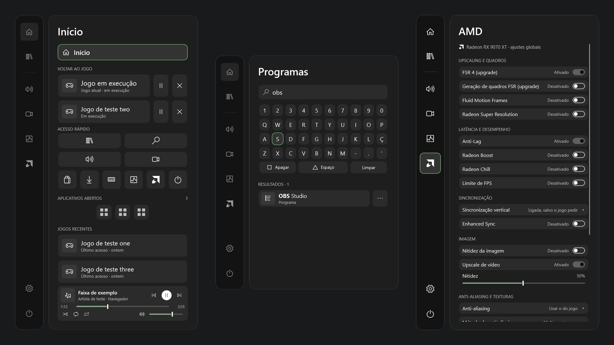
  <br>
  <sub>Início, Programas e AMD na 3.0.0, renderizados pela suíte de verificação a partir de dados de teste: jogos, apps e dispositivos são valores de teste, não de uma máquina real.</sub>
</p>

## O problema

O modo Xbox do Windows 11 transforma o PC num console, mas o overlay dele parte do princípio de que você usa um controle Xbox e o app Xbox. Com o Steam Big Picture como tela inicial e um DualSense pelo DSX, o botão PS pertence à Steam, a Game Bar original não conhece seus jogos da Steam e qualquer overlay disputa o controle com a Steam.

O XGB_P é a barra que falta nessa configuração: um toque no PS abre a barra sobre o jogo, o controle navega por ela e, ao fechar, o controle volta para a Steam sem conflito. Chegar lá exigiu resolver direito as partes difíceis:

- **Quem é dono do controle.** A Steam continua lendo o controle com a barra aberta. A barra só abre depois de o PS ser solto, coloca a Steam no layout de desktop por um ciclo `steam://forceinputappid` confirmado e bloqueia a navegação até a Steam confirmar a troca ([ADR 0041](docs/decisoes/0041-layout-de-desktop-da-steam-ao-abrir.md), [ADR 0074](docs/decisoes/0074-transferencia-rapida-do-steam-input-apos-soltar-ps.md)).
- **Foco no modo Xbox.** O shell mostra uma janela por vez e recusa o foco a um app aberto pela leitura direta do HID. A barra é uma janela de ferramenta que pede o foco explicitamente e o devolve à janela exata de onde veio ([ADR 0040](docs/decisoes/0040-foco-da-barra-e-camada-uiaccess.md), [ADR 0046](docs/decisoes/0046-entrega-de-foco-antes-de-ocultar-a-barra.md)).
- **Trocar de jogo sem overlay fantasma.** Abrir um segundo jogo da Steam com outro rodando deixava o overlay da Steam por cima. A barra fecha o jogo aberto, espera a saída do processo **e** o fim da sessão na Steam, e só então abre o próximo ([ADR 0070](docs/decisoes/0070-fechar-antes-de-iniciar-e-retorno-ao-inicio.md), [ADR 0072](docs/decisoes/0072-aguardar-encerramento-da-sessao-steam.md)).

## O que faz

| Painel | Recursos |
|---|---|
| **Início** | *Voltar ao jogo* primeiro: todos os jogos abertos, o atual na frente, com pausar, retomar e fechar pela identidade do processo. Depois o acesso rápido (quatro atalhos largos e seis quadrados), os apps abertos com segurar para fechar, três jogos recentes e o player de mídia da sessão ativa ([ADR 0105](docs/decisoes/0105-voltar-ao-jogo-acima-do-acesso-rapido.md)) |
| **Programas** | Pesquisa o índice do Menu Iniciar sem acentos, por iniciais e apelidos, ordenando pelo uso, digitada num teclado embutido controlado pelo controle. Abre pelo Explorer, para que o programa não herde a elevação da barra, e traz para a frente um programa que já está aberto ([ADR 0096](docs/decisoes/0096-pesquisa-de-programas-pelo-acesso-rapido.md)) |
| **Biblioteca** | Abre o Steam Big Picture direto em *Coleções → Todos*, por um canal local rápido quando o cliente da Steam é reconhecido |
| **Som** | Saída de áudio, volume e mute, mixer por aplicativo, microfone, fontes de mídia e posição da faixa. Com a barra aberta, o jogo ou app em foco toca na metade do volume |
| **Gravação** | Repetição instantânea, foto e gravação do Radeon ReLive pela ferramenta de comandos da própria AMD; últimas capturas com miniaturas; aviso ao gravar com o microfone mudo |
| **Desempenho** | Sensores do HWiNFO, FPS do RTSS e modo de energia do Windows. Dado ausente aparece como indisponível, nunca como número inventado |
| **AMD** | Ajustes gráficos globais pelo ADLX do driver, agrupados em upscaling e quadros, latência, sincronização, imagem, anti-aliasing e manutenção; cada mudança é relida do driver ([ADR 0100](docs/decisoes/0100-mais-opcoes-globais-da-amd-no-painel.md)) |
| **Configurações** | Dez seções, de Conexões (Wi-Fi, Bluetooth, bateria dos fones) e Tela (Luz noturna, a TV) a Controle (DSX, ícones dos botões, despertar pelo PS), o teclado virtual, a interface, o modo Xbox (ocultar a barra de tarefas, sair do modo), a inicialização, o histórico de atividade e Sobre ([ADR 0112](docs/decisoes/0112-trilho-lateral-como-opcao-e-ordem-das-configuracoes.md)) |
| **Controle e energia** | Estado do DualSense; suspender, reiniciar e desligar, cada um com uma segunda confirmação com foco em *Cancelar*; ligar e desligar a TV, quando a integração estiver configurada |

A **faixa de status** mostra a hora, a rede, a bateria do DualSense físico (não a do controle virtual do DSX), a bateria dos fones e um microfone riscado em vermelho enquanto o microfone padrão está mudo. Sobre uma tela do Big Picture, que já tem relógio, a barra esconde o próprio e leva a faixa para o lado do título do painel.

O **teclado virtual** digita em apps do desktop sem tomar o foco. Aberto à mão sobre um jogo catalogado, ele toma o foco para compor uma linha, devolve o foco e envia o texto no Menu; o Círculo cancela ([ADR 0101](docs/decisoes/0101-teclado-sobre-jogos-compor-e-enviar.md)). Sozinho, ele só abre no modo Xbox, quando um campo de texto recebe o foco.

**Integrações opcionais**, desligadas ou só de leitura até você configurar:

- **Fones Logitech LIGHTSPEED:** bateria, carga e autonomia pelo agente local do G HUB, só com pedidos de leitura ([ADR 0106](docs/decisoes/0106-bateria-de-fones-pelo-g-hub.md)).
- **TVs Samsung Tizen:** comandos de energia, estado de tela confirmada e regras optativas para suspensão, retomada, topologia das telas e HDR. A automação começa desligada, e a configuração é importada de uma instalação local já existente; ainda não há assistente de descoberta ([guia](docs/guias/tv-samsung-integrada.md), ADRs [0110](docs/decisoes/0110-integracao-da-tv-samsung.md)–[0111](docs/decisoes/0111-tv-integrada-comandos-automacao-e-retomada.md)).
- **Acordar o PC pelo PS:** diagnóstico só de leitura nas Configurações e na confirmação de Suspender, mais scripts reversíveis que **você** executa para armar só as instâncias Bluetooth do DualSense ([guia](docs/guias/despertar-pelo-ps.md), [ADR 0114](docs/decisoes/0114-bootps-reversivel-e-identificador-de-retomada.md)).

## Telas

| Configurações | TV Samsung (opcional) | Gravação |
|---|---|---|
| 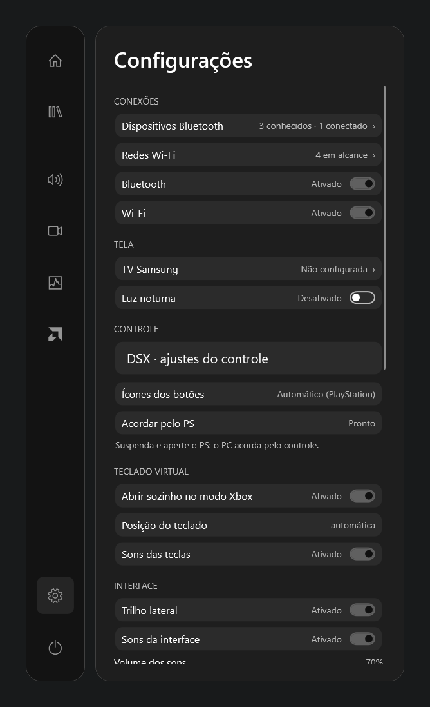 | 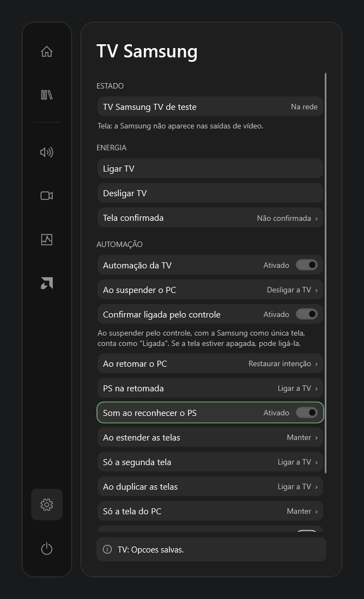 | 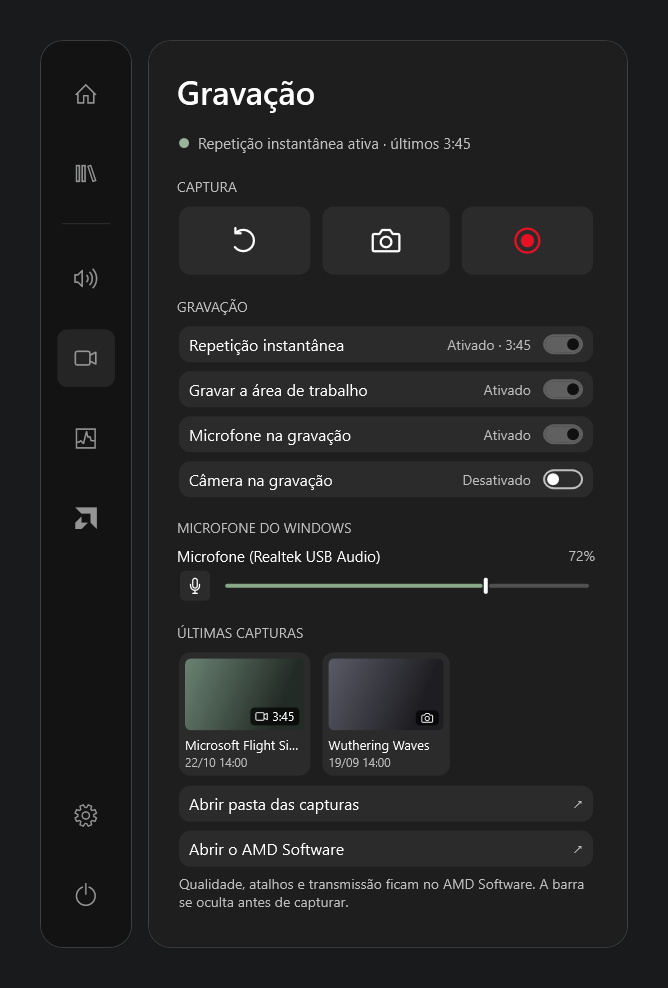 |
| **Som** | **Desempenho** | **Controle e energia** |
| 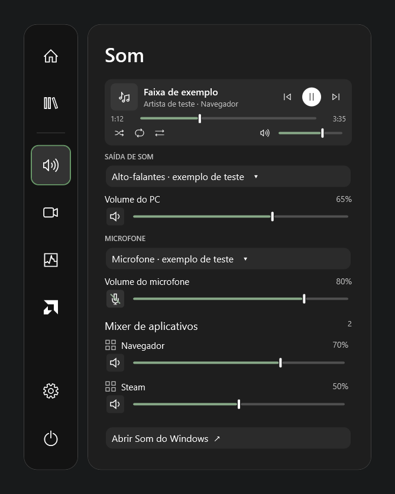 | 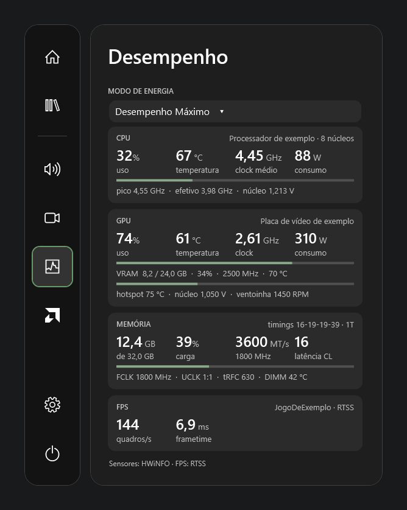 | 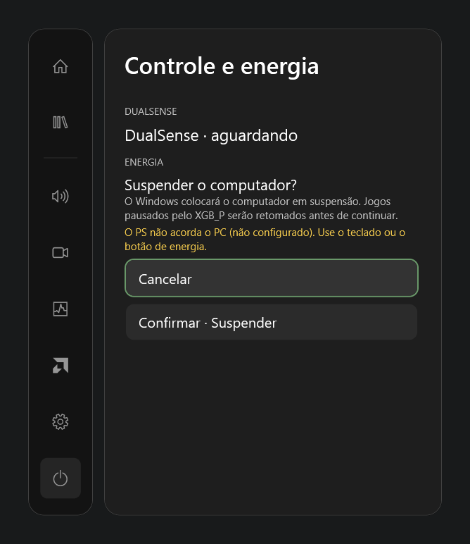 |

| Teclado virtual | Compondo sobre um jogo |
|---|---|
| 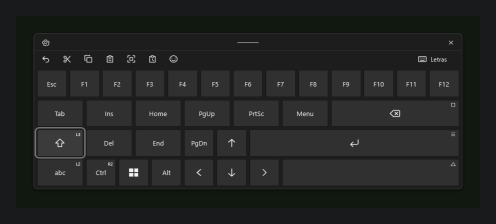 | 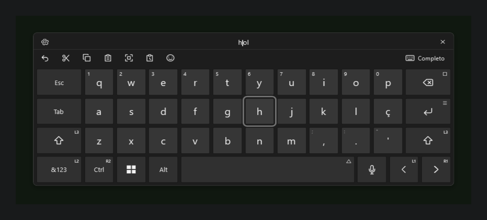 |

<details>
<summary>Sem o trilho lateral</summary>
<br>
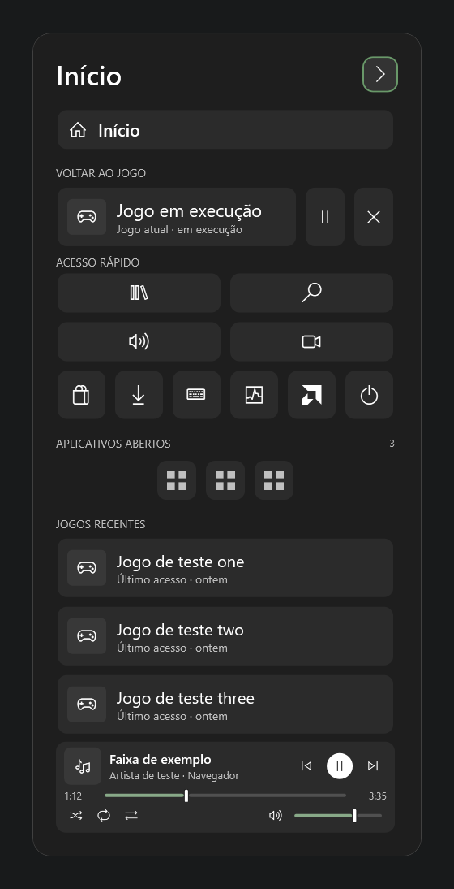
<br>
<sub>Configurações → Interface → <i>Trilho lateral</i> desliga o trilho. Cada painel mantém o título, com uma seta para o próximo; a escolha vale na hora e fica salva (<a href="docs/decisoes/0112-trilho-lateral-como-opcao-e-ordem-das-configuracoes.md">ADR 0112</a>).</sub>
</details>

<sub>Todas as telas são renders da build de testes da 3.0.0 com dados de teste. Mostram os layouts e estados que as suítes conferem, não a captura de uma sessão real. A origem de cada imagem está em [docs/images](docs/images/README.md).</sub>

## Resultados

| Medida | Resultado | Evidência |
|---|---|---|
| Latência da navegação na Steam | A Steam registra o comando em **30–138 ms** pelo canal local, contra **1.090–1.153 ms** pelo protocolo do shell | [ADR 0059](docs/decisoes/0059-despacho-local-da-navegacao-steam.md) |
| Custo das transições | **95,9% menos** passagens de Measure/Arrange por transição de painel; mediana da captura **57,4% menor** | [ADR 0057](docs/decisoes/0057-apresentacao-com-custo-limitado.md#resultados-medidos) |
| Produto sem código de teste | O `XGB_P.exe` tem **1,0 MB** na build de validação da 3.0.0, contra **1,9 MB** do `XGB_P.Tests.exe`; o produto recusa qualquer argumento `--verify*` | [Relatório do porte 3.0.0](docs/atualizacao-publica-2026-11-08.md#validação) |
| Suítes com dados de teste | Entre outras, **155** verificações do núcleo da TV, **41** do despertar pelo PS e **70** do layout do título, além de **11** casos isolados dos scripts de despertar, com registro e WMI substituídos | [Relatório do porte 3.0.0](docs/atualizacao-publica-2026-11-08.md#validação) |
| Gate local de qualidade | **22 modos de verificação** obrigatórios por candidata: suítes funcionais e temporais, rodadas de pausar/retomar/fechar em processos do próprio teste e diagnósticos somente leitura da máquina real | [Política de qualidade](quality/README.md) |
| Orçamento do observador | p95 abaixo de 1 s, menos de 5% de um núcleo e no máximo 16 handles retidos depois do aquecimento | [Política de qualidade](quality/README.md) |
| Decisões | **114 ADRs**, cada uma com contexto, consequências e limites | [Registros de decisão](docs/decisoes/README.md) |

## Arquitetura

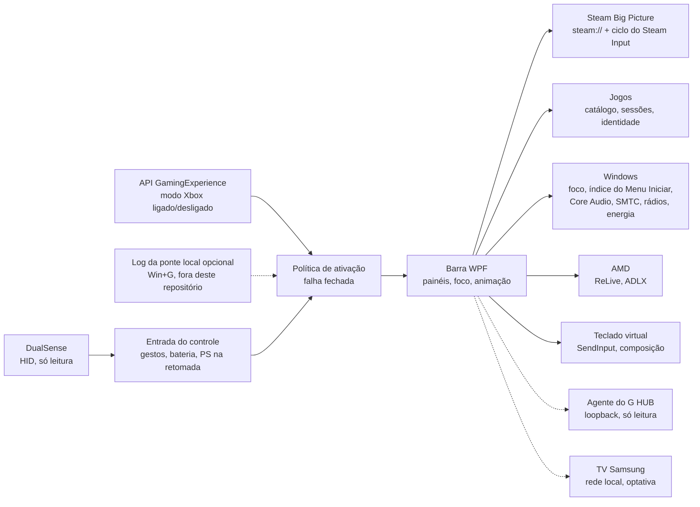

Um único processo WPF residente, no .NET Framework que já vem com o Windows: sem runtime para instalar, sem serviço, sem driver. A política de ativação lê o estado do modo Xbox pela API oficial e **falha fechada**: se o estado é desconhecido, a barra não abre. As ações sobre jogos rodam em transações serializadas, identificadas pelo ID **e** pela criação do processo, e um diário gravado antes de cada pausa permite que a próxima abertura retome os jogos depois de uma queda. A TV roda no mesmo processo, numa fila serializada própria, e o PS depois da retomada vem do mesmo e único leitor HID.

Detalhes: [Arquitetura](docs/arquitetura.md) · [Requisitos](docs/requisitos.md) · [ADRs](docs/decisoes/README.md) · [Referências técnicas](docs/referencia/)

## Invariantes

| Invariante | Como é garantida |
|---|---|
| O DualSense é só leitura | Nenhum relatório de LED, vibração ou gatilho é enviado, então a barra não briga com a Steam nem com o DSX. O gate recusa `HidD_SetOutputReport` e `HidD_SetFeature` no código |
| Sem injeção, nenhum binário da Microsoft alterado | Só APIs públicas. O gate recusa `WriteProcessMemory`, `CreateRemoteThread` e `VirtualAllocEx` ([ADR 0001](docs/decisoes/0001-nao-modificar-binarios-microsoft.md)) |
| Mudanças no sistema são do usuário | Sem pacotes, certificados, serviços ou tarefas agendadas. Elevação só pelo UAC normal. Os scripts da política de despertar são executados pelo usuário, mostram o efeito com `-WhatIf` e desfazem só o próprio backup |
| Processos são tratados pela identidade | Pausar, retomar e fechar conferem ID e criação do processo no mesmo handle, para que um ID reaproveitado não seja confundido com o jogo original |
| Erro é informado, nunca inventado | Prazos esgotados e recusas terminam numa mensagem explícita; não existe sucesso por timeout. Um comando de energia da TV entregue, ou possivelmente entregue, nunca é repetido sozinho |
| Outros dispositivos são lidos, não comandados | Do G HUB, só a lista de dispositivos e o estado da bateria; o observador do microfone nunca chama `SetMute` |
| Nada privado no Git | A CI recusa binários, certificados, sons e identidades de pacote da Microsoft; o Gitleaks varre todo o histórico. Os exemplos da TV usam identificadores fictícios |

## Requisitos

- Windows 11 x64 com o modo Xbox. O app também roda no desktop.
- Steam com o Big Picture como app inicial do modo Xbox.
- DualSense pelo [DSX](https://store.steampowered.com/app/1812620/DSX/), com o controle físico liberado para o XGB_P no [HidHide](https://github.com/nefarius/HidHide).
- Opcionais: AMD Software: Adrenalin Edition (painéis Gravação e AMD), HWiNFO e RTSS (painel Desempenho), Logitech G HUB (bateria de fones LIGHTSPEED), uma TV Samsung Tizen com configuração local já existente (integração da TV).

**Como abrir a barra.** No modo Xbox, aperte PS ou use o ícone da bandeja. Abrir pelo Win+G depende de uma ponte local com o shell que não é distribuída ([ADR 0002](docs/decisoes/0002-identidade-do-pacote-da-game-bar.md)). Sem ela, o Win+G continua abrindo a Game Bar original, e todo o resto funciona.

## Como começar

**Ainda não há release publicada.** O [workflow de release](.github/workflows/release.yml) gera uma a partir de uma tag `v*`, com o ZIP, o `SHA256SUMS.txt` e um atestado de proveniência do build. Até lá, compile a partir do código. Não é preciso SDK: o compilador de C# já vem com o Windows.

```powershell
powershell -NoProfile -ExecutionPolicy Bypass -File .\scripts\compilar-xgb.ps1 -Verificar
```

Isso gera o `XGB_P.exe` e o `XGB_P.Tests.exe` em `bin\app` e roda a suíte funcional com dados de teste. Configuração, HidHide, onde ficam os dados e reversão: [instalação e uso](docs/guias/instalacao-e-uso.md).

Quando houver uma release, confira o download pelo `SHA256SUMS.txt` e pelo atestado antes de abrir:

```powershell
gh attestation verify .\XGB_P-3.0.0-win-x64.zip --repo Sitr3n01/XGB_P
```

O executável não tem assinatura Authenticode, então o SmartScreen pode avisar na primeira abertura.

## Situação do projeto

**v3.0.0 candidata nos fontes — validação física pendente.** Os recursos acima estão implementados e passaram no gate local do porte 3.0.0: o script de CI (verificações estáticas, as duas builds, os casos dos scripts de despertar e a recusa dos modos de teste pelo produto), seis execuções de verificação com recibo e a revisão dos renders. O app está em uso diário na máquina do autor.

Em aberto, e acompanhado no [roadmap](docs/roadmap.md):

- **A matriz física no modo Xbox:** Steam, DSX, jogos reais, pesquisa de programas, teclado sobre jogos, G HUB, o botão de mudo do DSX, a TV e DPI. Ações de energia reais e uma TV real não foram ensaiadas nesta versão.
- **A CI no GitHub.** A última execução no `main`, ainda na 2.1.0, falhou porque o Windows limita a janela ao tamanho da tela; no runner, a barra era montada menor que os 1920 × 1080 pedidos pelas suítes. A build de testes agora tira esse limite e sempre monta as suítes no tamanho pedido. A correção passa localmente, inclusive com uma tela de 1024 × 768 emulada, mas ainda não rodou no GitHub.
- **O registro de retomadas** trata o PS visto depois de uma retomada como correlação, nunca como prova de que o controle acordou o PC.

O app foi feito para uma configuração e testado numa máquina (Ryzen 7 7700X, Radeon RX 9070 XT, Windows 11 build 26300). A integração com a Steam lê arquivos locais da própria Steam, que não são um contrato público e podem mudar a qualquer atualização.

## Práticas de engenharia

**Duas builds, um código.** `XGB_P.exe` e `XGB_P.Tests.exe` saem do mesmo `src/`. A build de testes soma `tests/` e o símbolo `XGB_VERIFY`; a build de produto não tem nenhum código de verificação.

**Recibos, não logs.** Cada execução de verificação grava um recibo ligado a um GUID novo, ao modo, ao SHA-256 do executável e a uma janela UTC. O gate recusa recibos antigos, de outra build ou adulterados, e tem testes negativos para cada campo. Uma impressão digital dos fontes, tirada antes e depois da bateria, recusa a execução se o código mudou no meio.

**Substitutos para efeitos.** Energia, Steam, rádios, o transporte da TV, o registro e o WMI são trocados por substitutos nas suítes; os testes de TLS da TV usam um par efêmero restrito ao loopback. As verificações "live" só leem a máquina real ou agem sobre processos e janelas criados pelo próprio teste.

**Catracas.** O `quality/policy.json` limita o tamanho dos arquivos e a largura das linhas. A dívida antiga fica registrada por arquivo e só pode diminuir; o porte 3.0.0 reduziu 17 limites e não ampliou nenhum.

**Registros de decisão.** Toda mudança de comportamento que importa tem uma [ADR](docs/decisoes/README.md), inclusive as que reverteram uma decisão anterior, com o motivo.

## Como foi feito

Projeto individual, construído com assistentes de programação com IA (Claude Code e OpenAI Codex). O dono define a direção e toma as decisões que os documentos registram: escopo, quais concessões são aceitáveis, quais propostas de design foram aprovadas, o que foi validado fisicamente e o que não foi. Toda mudança, venha de quem vier, passa pelo mesmo gate.

O histórico público começa na v2.1.0. O desenvolvimento anterior, com os registros de sessão, as evidências brutas e a ponte local de ativação, fica num arquivo privado porque contém dados desta máquina.

## Mapa do repositório

```
src/app/        aplicativo WPF: painéis, ativação, foco, Steam, jogos, programas,
                teclado, TV e despertar nas Configurações, animação
src/lib/        integrações com o Windows por área: dualsense, gaming, games, windows,
                audio, media, hardware, network, display, amd, input, power, tv, runtime
tests/          suítes de verificação, compiladas só no XGB_P.Tests.exe
tools/          diagnósticos somente leitura (leitor do DualSense, monitor do modo Xbox)
                e o microbenchmark de apresentação
scripts/        build, bateria de verificação, gates de qualidade e de CI, empacotamento
                e os scripts de despertar pelo PS, executados pelo usuário
quality/        política do gate (versão, catracas, modos obrigatórios, aprovações manuais)
licenses/       licença da arte do DualSense embutida
docs/           arquitetura, requisitos, roadmap, ADRs, referências, design, guias
.github/        CI, CodeQL, release, Dependabot, modelos de issue e de pull request
```

## Documentação

| Documento | Conteúdo |
|---|---|
| [Instalação e uso](docs/guias/instalacao-e-uso.md) | Requisitos, HidHide, abrir e encerrar, dados, inicialização, reversão |
| [TV Samsung](docs/guias/tv-samsung-integrada.md) | Preparação local, operação, validação e reversão da integração opcional da TV |
| [Despertar pelo PS](docs/guias/despertar-pelo-ps.md) | Diagnóstico, os scripts reversíveis e o registro de retomadas |
| [Desenvolvimento](docs/guias/desenvolvimento.md) | Ferramentas, builds, bateria de verificação, gates, releases |
| [Arquitetura](docs/arquitetura.md) | Componentes, ativação, foco e Steam, operações, dados |
| [Requisitos](docs/requisitos.md) | Escopo, controles, recursos, dependências, critérios de aprovação |
| [Roadmap](docs/roadmap.md) | O que está pronto, o que está pendente e o que fica fora do escopo |
| [Relatório do porte 3.0.0](docs/atualizacao-publica-2026-11-08.md) | O que mudou desde a 2.1.0, como foi adaptado e validado, o que não foi testado |
| [ADRs](docs/decisoes/README.md) | Registros de decisão, com índice |
| [Referências](docs/referencia/) | Fatos de Windows, Steam, DualSense e AMD dos quais o código depende |
| [Design](docs/design/README.md) | Paleta, animação, som e layout do Início |
| [Changelog](CHANGELOG.md) | Mudanças relevantes por versão (em inglês) |
| [Política de segurança](SECURITY.md) | Relato privado e as invariantes de segurança do app |
| [Contribuição](CONTRIBUTING.md) · [Código de conduta](CODE_OF_CONDUCT.md) | Como as mudanças são feitas e revisadas |

## Licença

[Apache License 2.0](LICENSE). O contorno do DualSense é a arte do PS5 do [Controllercons](https://github.com/controllercons/controllercons.github.io), de Kieran McClung, sob a [SIL Open Font License 1.1](licenses/Controllercons-OFL-1.1.txt). Produtos de terceiros, marcas e a declaração de não afiliação estão no [NOTICE](NOTICE). O XGB_P é um projeto independente, sem vínculo com Microsoft, Sony, Valve, AMD, Logitech ou Samsung.
